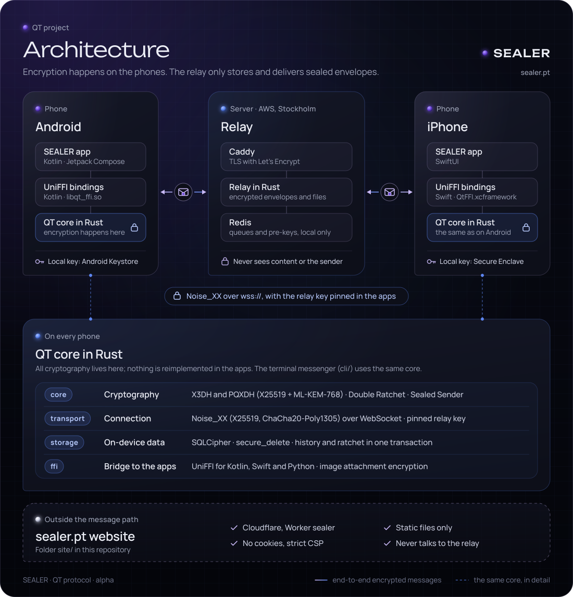
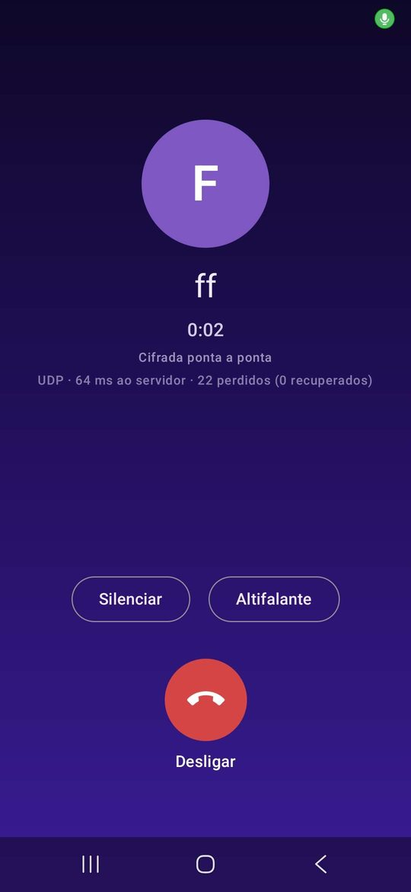

# QT

<p align="center"></p>

The apps are called **SEALER**; QT is the name of the protocol and of this repository.

**Test version (Android 0.9.4, iPhone 0.9.3), not audited.** An E2EE messenger with post-quantum
cryptography (X3DH, PQXDH, Double Ratchet, Sealed Sender, Noise Protocol),
all implemented in Rust, with Android and iPhone apps and a cloud relay,
already working end to end. **It is not a finished product yet and must not be
used for sensitive information.** See "Be honest with me: does this
actually work?" below.

[Ler isto em português →](README.md)

## Context

This project grew out of a genuine interest in privacy and systems
security, specifically the question of how to build communication
where privacy is guaranteed by technical design and not only by a
written policy (the "data protection by design" that the GDPR asks for).
Rather than stopping at theory, the goal was to actually
implement and test every piece: not pseudocode, not diagrams, but code that
compiles, runs, and has automated tests confirming it does what it claims.

## Why this exists (beyond the technical exercise)

Almost every popular messenger asks for your phone number to sign up.
Even when message content is private, that registration creates a
trail: who talks to whom, when, how often. For companies this is also
a compliance matter: the GDPR requires data protection by design and data
minimisation, and every piece of data a service keeps is data that can be
exposed in a breach.

QT tries to answer this with engineering, not just a privacy policy:
identity based on a cryptographic key (no phone, no email), end-to-end
encryption the server itself cannot break, and open source code so anyone
can verify there are no hidden tricks.

## Be honest with me: does this actually work?

Yes, end to end, as a test version (**Android app 0.9.4 and iPhone app 0.9.3**), in closed testing with a few people. **It has not been independently audited and must not be used for real conversations or sensitive information.**

### What the app already does (19 October 2026)

- **End-to-end encrypted voice calls** (new in Android 0.9.4), tested between two phones with very good quality. For now, both people need the app open. See "Voice calls" below.

- **One-to-one and group chats** (up to 10 people, 3 admins), between Android and iPhone, with encrypted history on the phone and *Sent / Delivered / Seen* indicators.
- **Photos, GIFs, voice messages and files up to 25 MB** (PDFs, documents...), one-to-one and in groups. Each file is encrypted on the phone with its own key and deleted from the relay once downloaded, or after 24 hours.
- **Push notifications with the app closed:** a generic notice ("You have new messages"), without the sender's name or the text. Since Android 0.9.6 the app decrypts in the background, on the phone, so calls can ring with the app closed; with the app lock on, nothing is decrypted without the passcode.
- **Invites by QR code**, reactions, blocking contacts, online / offline for contacts only (encrypted) and an app lock with its own passcode, fingerprint or face (for now only on Android).
- **Delete your account** on the phone and on the server, with one tap.
- **Protocol security (0.9.3):** PQXDH v2 (X25519 + ML-KEM-768), keys that rotate every 7 days and one-time keys served by the relay, message padding (the relay cannot tell short messages from receipts), proof of work for new accounts and per-account limits on the relay. 0.9.3 apps do not talk to earlier versions.

### Tested

- Cryptographic core, transport, relay, local storage and FFI in Rust, with the test suite passing (`cargo test --workspace`).
- Relay on an AWS EC2 instance in Stockholm, at `wss://relay.sealer.pt` (HAProxy with a Let's Encrypt certificate), with Redis only on `127.0.0.1` and protected by an ACL.
- Signed *release* Android app, tested on three Samsung phones and the emulator; iPhone app 0.9.3 built and tested on an iPhone.
- Field test with five devices on three platforms (2 real Android phones, 1 Android emulator, 1 iPhone and 1 Mac), with simultaneous, continuous sending: no message lost. See [`docs/field-tests.md`](docs/field-tests.md).
- Relay with 8,000 simultaneous connections through HAProxy with no failures (about 40 KB per connection). See "The relay in numbers" below.

### Still missing

- **Encrypted one-to-one voice calls:** the protocol, the call server and the audio engine are built and tested; they still have to be wired into the app (Android first). See "Voice calls" below.
- **Distribution through Google Play and the App Store** (today testers install the app by hand). Already prepared: account deletion, privacy policy and answers for the forms ([`docs/google-play.md`](docs/google-play.md)).
- **Production infrastructure:** redundancy, backups and server alerts.
- **Independent security audit.**

**Next stages:** *closed testing* (now, 0.9.x) → *beta* (Google Play and App Store, more testers) → *1.0* (after an external audit).

## Architecture

<!-- Generated by site/scripts/architecture_diagram.py (see site/README.md, section 14). -->


## What's already built

| Piece | What it does | Confidence |
|---|---|---|
| `core/` | Session establishment (X3DH + post-quantum variant) and continuous encryption (Double Ratchet), the same design used by Signal | ✅ Tested (over 40 automated tests, including cases designed to fail) |
| `transport/` | Network connection protection (Noise Protocol) over WebSocket | ✅ Tested with real WebSocket connections, not simulated |
| `server/` | The "mailman": delivers messages without ever seeing the content or knowing who sent them, and keeps encrypted images for 24 hours at most. Also includes, separately, the voice call relay (UDP, anonymous rooms) | ✅ Tested, including surviving being force-killed (`kill -9`) and against the production Redis command list; the call relay is in production |
| `call/` | The voice call engine: Opus 1.6 with DRED and neural PLC, adaptive jitter buffer and the connection to the call relay (UDP, with a WebSocket fallback) | ✅ Tested in Rust, with end-to-end calls through a local relay and simulated packet loss; not in the app yet |
| `storage/` | Stores your identity and conversations on disk, encrypted | ✅ Tested, including confirming a wrong password opens nothing |
| `cli/` | The messenger in the terminal (`messenger`), on the same core as the apps, plus a visible protocol demo (`messenger_demo`) | ✅ Tested end to end against a real relay: terminal ↔ terminal and terminal ↔ a client identical to the apps' |
| `ffi/` | The bridge connecting all of this to Kotlin (Android), Swift (iOS) and Python: history, outbox, images, app lock | ✅ Tested in Rust (including crossed sessions and images) and from Python |
| `android/` | Android app (Kotlin/Compose); all cryptography stays in Rust | ✅ Version 0.9.4 (with voice calls), signed release tested on real phones through the relay on AWS |
| `ios/` | iPhone app (SwiftUI), same as the Android one, on the same Rust core | ✅ Version 0.9.3 built on a Mac and tested on an iPhone, exchanging messages with the Android apps through the relay on AWS |
| `deploy/` | Relay install on EC2: Redis on localhost only with ACLs, sandboxed systemd service, automatic TLS | ✅ Used in the current deployment |

## The relay in numbers

The relay is small on purpose: it only passes encrypted messages along, keeps no history (encrypted images stay there for 24 hours at most), and the heavy cryptography runs on the phones. Measured with 10,000 connections open at the same time, each one polling for messages every 3 seconds, as the apps do while open:

| | Result |
|---|---|
| Connections open at the same time | **10,000 of 10,000, 0 failures** |
| Relay memory | **138 MB in total, about 14 KB per connection** (starts at 4 MB) |
| Requests answered | **~3,300 per second, 0 errors** |
| CPU per request | about 0.05 ms in the relay and 0.02 ms in Redis (24 % of one core for all 10,000 connections) |
| CPU with idle connections | 0 % |

With messages flowing all the time (50 pairs of connections sending as fast as possible), the relay delivered about **16,900 messages of 200 B per second** and **6,000 of 4 KB**, with 95 % of messages reaching the recipient in under 10 ms (200 B) and 26 ms (4 KB). A 25 MB image was uploaded to the relay in 0.3 s and downloaded in 0.4 s.

Measured on a local 2 vCPU machine, without the proxy's TLS and without a real network in between, so the full server uses more than this. How it was measured, how to repeat it and what was left out: [`docs/performance.md`](docs/performance.md) (in Portuguese).

## Real-world times, between phones

The numbers above are for the relay alone. With real phones (three Samsung phones, in Viseu and Cascais, on Wi-Fi and mobile data, with the relay in Stockholm), measured by the relay itself on 19 October 2026, over an hour with 110 messages:

| | Typical message (median) | 95% of messages |
|---|---|---|
| From the sender's phone to the server | **42 ms** | 57 ms |
| From the server until the other phone has the message | **141 ms** | 18 s |

The apps wait on an open connection and the relay delivers each message the moment it arrives. The few slow messages go to phones that were asleep: the notification wakes them up and the message arrives when the app opens.

## Voice calls (in development)

**One-to-one voice calls already work in the Android app 0.9.4**, tested on 19 October 2026 between two phones, with very good quality. For now, both people need the app open; ringing with the app closed is the next phase. iPhone comes later.

<p align="center"></p>

| Phase | What it is | Status |
|---|---|---|
| 1. Signalling and encryption | Calling, ringing, answering and hanging up travel as encrypted messages inside the Double Ratchet. Each side contributes a random secret, and the audio keys come from both | ✅ Done (`core/src/call.rs`, `ffi/src/call.rs`) |
| 2. Call relay | A separate service on the server (UDP 443) that only forwards encrypted audio packets | ✅ In production, tested from home |
| 3. Audio engine | Opus 1.6 with DRED and neural PLC, adaptive jitter buffer and the connection to the relay | ✅ Done and tested in Rust (`call/`) |
| 4a. Android app, with the app open | Call button, call screen, microphone with the phone's echo cancellation, speaker and mute | ✅ Done (Android 0.9.4), tested on real phones |
| 4b. Ringing with the app closed | Incoming-call alert with the app closed or the phone locked, with Android's call screen | ⏳ Next |

**How it protects privacy:**

- **Audio always goes through the server and never directly between phones.** The person calling you never learns your IP address, and you never learn theirs.
- **The server does not know who is talking to whom.** Each phone joins a "room" with a request encrypted to the server's key, without saying which account it is. The server only sees two addresses exchanging encrypted packets it cannot open.
- **Every packet has the same size and the same rhythm** (one every 20 ms, silence included). With variable sizes, it has been shown that phrases can be guessed from packet sizes alone, even when encrypted.
- **A call starts as an ordinary message**, so the server does not even know it is a call, and the encryption inherits PQXDH's post-quantum protection.
- **No logs:** the call server keeps no IP addresses or times, only per-minute counts. The remaining limit: while a call lasts, the server could, in theory, match the room's IP address with the IP address connected to receive messages.

**How it copes with bad networks:**

- **DRED (Opus 1.6):** every packet carries a heavily compressed copy of roughly the previous 200 ms. When packets are lost, the next one rebuilds what was missing. In a test with 15% of packets lost, all of them were rebuilt.
- **Neural PLC:** when there is nothing to rebuild from, a model fills the gap instead of a hard cut.
- **Adaptive jitter buffer:** holds between 40 and 200 ms of audio, depending on how much the network varies.
- **Moving from Wi-Fi to mobile data does not drop the call**, and there is a fallback over `wss://relay.sealer.pt/call` for networks that block UDP.

**Measured on 19 October 2026**, from home in Portugal to the server in Stockholm: joining a room in 66 ms and a PC → server → PC → server → PC round trip of 128 ms, which means about **64 ms of network time one way** between two phones. A call uses about 35 MB per hour in each direction. The formats are in section 18 of [`docs/protocol-spec.md`](docs/protocol-spec.md).

## What's missing, plainly

Beyond the list above ("Still missing"), longer term:

- Several independent servers collaborating (federation), so that one server failing does not stop the whole network
- An independent security audit, done by someone other than me

## Try it yourself

The fastest way to see this working is this command, which shows a full
encrypted conversation between two fictional people, step by step:

```bash
cargo run -p qt_cli --bin messenger_demo
```

### Requirements to build

```bash
sudo apt install redis-server libsqlcipher-dev cmake
redis-server --daemonize yes
```
Rust 1.82 or newer, via [rustup](https://rustup.rs). `cmake` builds Opus for the voice calls.

### Running the tests

```bash
cargo test --workspace                          # everything, post-quantum included (needs Redis, above)
cargo test -p qt_core --features pq              # the cryptographic core only
```

The `server/tests/redis_acl.rs` test starts its own Redis with the production command list; without `redis-server` installed it is skipped.

### Two people talking through the relay (on your PC)

```bash
cargo run --release -p qt_server --bin relay_server &       # local relay on 127.0.0.1:9443

# in two separate terminals (each one is a "person"):
cargo run -p qt_server --example peer -- --relay ws://127.0.0.1:9443 --db alice.db
cargo run -p qt_server --example peer -- --relay ws://127.0.0.1:9443 --db bob.db
# in each: /id shows the Public ID; /add <the other's ID>; then type messages
```

The `peer` client uses exactly the same protocol as the Android app. Each person's identifier is derived from their public key: nobody chooses a "username," on purpose. `ws://` is only accepted for `localhost` in debug builds; otherwise the transport requires `wss://`.

### The messenger in the terminal (talks to the phones)

`messenger` uses the same core and the same relay as the apps: what you type on the PC reaches the phone, and the other way round.

```bash
cargo build --release -p qt_cli --bin messenger
export QT_RELAY_URL=wss://<your-relay>  QT_RELAY_PIN=<the relay's Noise public key>
M=./target/release/messenger

$M identity --db me.sqlite                 # once: creates the identity and prints your QT Public ID
$M add --db me.sqlite Ana qt1:...          # saves a contact (the ID their app shows)
$M send --db me.sqlite --to Ana            # the message is asked for in the terminal
$M listen --db me.sqlite                   # keeps receiving (Ctrl+C to quit)
$M history --db me.sqlite Ana              # history, stored encrypted
$M remove --db me.sqlite Ana               # deletes the contact, its messages and the conversation keys
```

The passphrase is always asked for in the terminal, hidden (or read from one line of stdin with `--passphrase-stdin`, for scripts). Argon2id turns it into the database key and the key for the contact list, which is encrypted too.

### Hearing a call on your PC (echo)

The `tools/call-demo` tool uses the same call engine: your voice goes to the call server and back, and you hear yourself with the real delay of the network, the jitter buffer and Opus. Use headphones (there is no echo cancellation on the PC).

```bash
sudo apt install cmake libasound2-dev
cd tools/call-demo
cargo run --release -- eco              # microphone -> server -> headphones
cargo run --release -- eco --perda 15   # drops 15% of packets: hear DRED rebuilding them
cargo run --release -- eco --ws         # uses the WebSocket fallback
```

### Generating Android/iOS/Python bindings

```bash
./ffi/generate_bindings.sh
```

## Android app

The Rust core is the only cryptographic backend of the Android app (Kotlin/Compose): `QtClient` API via UniFFI, SQLCipher storage with a key from the Android Keystore, PQXDH (X25519 + ML-KEM-768) + Double Ratchet + Sealed Sender, authenticated relay with *at-least-once* delivery, push notifications (FCM, generic notice) and voice calls (`call/` engine). **Test version (0.9.4), not audited.**

```bash
export ANDROID_NDK_HOME=$HOME/Android/Sdk/ndk/<version>
ABIS="arm64-v8a armeabi-v7a" ./scripts/build-android.sh   # libqt_ffi.so (16 KB) + Kotlin bindings
cd android && ./sync-native.sh ..                          # copy into the app
# then open the android/ folder in Android Studio
```

The *release* build requires your own keystore and the production relay (`qtRelayUrl` / `qtRelayPin` in `android/gradle.properties`); in that build the relay is fixed and not shown in the UI. Use NDK 27 or newer (with r26d the build of the bundled OpenSSL failed). Step by step in [`android/README.md`](android/README.md) (Portuguese).

* Integration and build guide: [`docs/android-integration.md`](docs/android-integration.md)
* API reference: [`docs/ffi-api.md`](docs/ffi-api.md)
* Protocol (§8–18 = current formats, including calls): [`docs/protocol-spec.md`](docs/protocol-spec.md)
* Threats and limitations: [`docs/threat-model.md`](docs/threat-model.md), [`docs/known-limitations.md`](docs/known-limitations.md)

(These documents are in Portuguese.)

## iPhone app

Needs a Mac with Xcode and [XcodeGen](https://github.com/yonaskolb/XcodeGen):

```bash
./scripts/build-ios.sh          # builds the Rust core for iPhone and the simulator
cd ios && xcodegen && open SealerMessenger.xcodeproj
```

Step by step, Apple accounts and the differences from Android in [`ios/README.md`](ios/README.md) (Portuguese).

## Relay on AWS

On a fresh EC2 instance with Ubuntu 24.04 (Security Group with only 22, 80 and 443 TCP, plus 443 UDP for calls):

```bash
curl -fsSLO https://raw.githubusercontent.com/moral666/QT/site-sealer/deploy/aws/setup-ec2.sh
sudo bash setup-ec2.sh
```

It installs Redis (`127.0.0.1` only, minimal-ACL user), the relay as a sandboxed systemd service, the voice call relay (UDP 443, a separate service with no access to Redis) and HAProxy with a TLS certificate (certbot, automatic renewal), and prints the `wss://` URL and pinning key for the app. Encrypted images are kept in `/var/lib/qt/anexos` (2 GB in total and 24 hours each at most, by default).

To update a relay that is already installed, run the same script again: it fetches the new code and rebuilds, but keeps the Noise key (the apps' pin does not change) and the Redis password. The build runs on the instance itself and needs room: an 8 GB disk ended up almost full, the current relay uses 20 GB. Details in [`docs/deploy-wss.md`](docs/deploy-wss.md).

## How the project is organized

```
core/        The heart: end-to-end encryption, no external dependencies
transport/   Protects the network connection
server/      Delivers messages without being able to read them
storage/     Stores everything on disk, encrypted
cli/         The messenger in the terminal (same core and relay as the apps)
demo/        Combines core+transport into a single test, to see it all in action
ffi/         The bridge to Kotlin, Swift and Python
call/        The voice call engine (Opus, jitter buffer, network)
android/     The Android app (Kotlin/Compose)
ios/         The iPhone app (SwiftUI)
branding/    Logo, icons and font of the SEALER brand
site/        The sealer.pt website (static page on Cloudflare)
deploy/      Relay server install (AWS, Redis, systemd)
scripts/     Builds for Android and iPhone, and measurements (relay and phone)
tools/       Test tools (voice call echo on the PC)
docs/        The full technical specification, and the design history
```

Each piece has its own tests, kept next to the code (`tests/`).

## Want the technical details?

- [`docs/protocol-spec.md`](docs/protocol-spec.md) explains, section by section, exactly how each piece works internally: which algorithms, which decisions, and what's still missing in each one.
- [`docs/threat-model.md`](docs/threat-model.md) explains who and what this protects against and, just as importantly, who and what it does **not** protect against. Recommended reading before trusting any security claim made here.
- [`docs/known-limitations.md`](docs/known-limitations.md) lists the known limitations, by impact.
- [`docs/field-tests.md`](docs/field-tests.md) and [`docs/performance.md`](docs/performance.md) record the tests with real devices and the relay measurements.
- [`ROADMAP.md`](ROADMAP.md) shows what's left, in priority order.
- [`CHANGELOG.md`](CHANGELOG.md) shows the history of what's already changed.

(The documents in `docs/`, the roadmap and the changelog are in Portuguese.)

## License

QT is offered under a dual license:

- **Open source:** GNU Affero General Public License, version 3 or later (AGPL-3.0-or-later). In plain terms: anyone can use, study and modify this code freely, but if someone takes it to offer a service (even just over the internet, without "distributing" software in the traditional sense), they're required to also share the source of those modifications.
- **Commercial:** organisations that need terms other than the AGPL can obtain a commercial license through a written agreement with the author.

The commercial license allows specific terms of use, integration, distribution, deployment, support, maintenance and other commercial rights to be set by contract.

Third-party components and dependencies used by QT remain subject to their own licenses.

See [`LICENSE`](LICENSE) for the AGPL and [`LICENSE-COMMERCIAL.md`](LICENSE-COMMERCIAL.md) for the commercial licensing model.

## Want to help or report a problem?

- `CONTRIBUTING.md` explains how to propose changes, and has extra
  (reasonable) rules for anyone touching cryptography code
- `SECURITY.md` explains how to report a vulnerability privately. Please
  don't open a public issue for that
