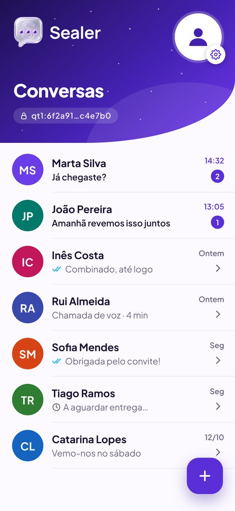
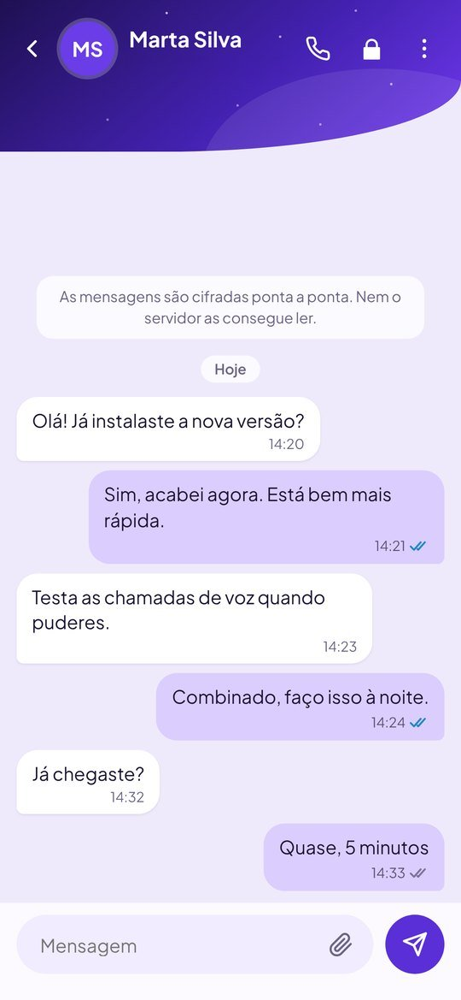
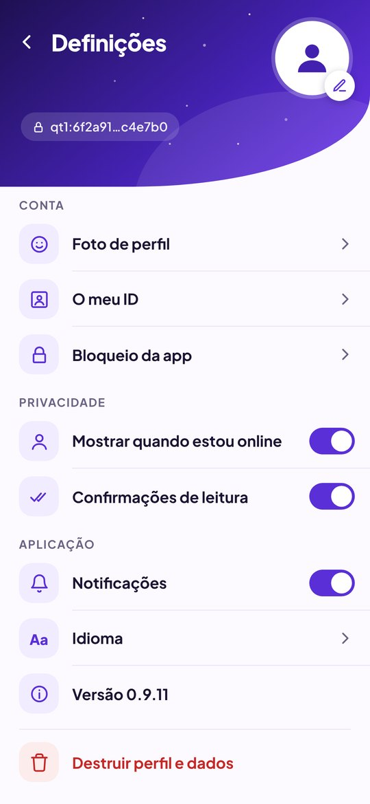
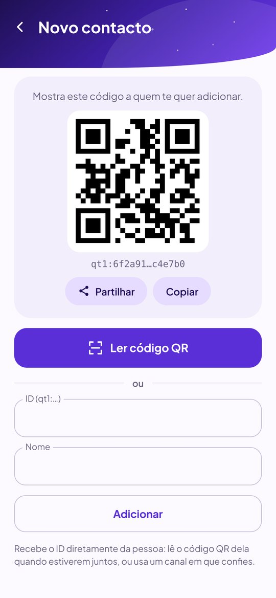
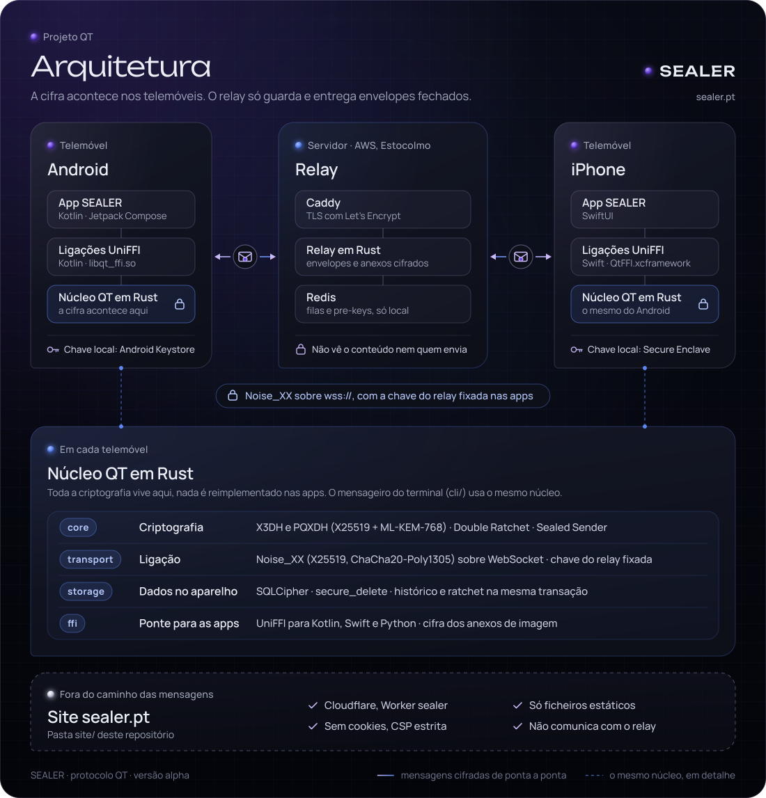

# QT

<p align="center"></p>

**SEALER** é um mensageiro privado: sem número de telefone, sem email, com cifra ponta a ponta e proteção pós-quântica. **QT** é o nome do protocolo e deste repositório.

**Estado:** versão de testes, em testes fechados. App Android **0.9.25**, app iPhone **0.9.25**, servidor em produção.

[Read this in English →](README.en.md)

<p align="center">
  
  
  
  
</p>
<p align="center"><sub>App Android. Os nomes e as mensagens são exemplos.</sub></p>

## Porque existe

Quase todos os mensageiros pedem o número de telefone. Mesmo com as mensagens cifradas, esse registo deixa um rasto: quem fala com quem, quando e com que frequência. O QT responde a isto com engenharia, não só com uma política de privacidade:

- **A tua identidade é uma chave criptográfica**, criada no telemóvel. Não há telefone, email nem nome de utilizador.
- **Cifra ponta a ponta** que nem o servidor consegue abrir. O servidor também não sabe quem enviou cada mensagem.
- **Código aberto**, para qualquer pessoa poder verificar o que a app faz.

É também um exemplo prático de "proteção de dados desde a conceção", como pede o RGPD: cada peça foi construída e testada a sério, com testes automáticos a confirmar que faz o que diz.

## O que a app faz

- **Conversas a dois e em grupo** (até 10 pessoas, 3 administradores), entre Android e iPhone, com *Enviado / Entregue / Visto*.
- **Chamadas de voz cifradas** no Android e no iPhone, também entre os dois. No Android tocam com a app fechada ou o telemóvel bloqueado, com toque próprio.
- **Fotos, GIFs, mensagens de voz e ficheiros até 25 MB.** Cada ficheiro tem uma chave própria e sai do servidor quando é descarregado (ou ao fim de 24 horas).
- **Notificações com a app fechada**, sempre genéricas ("Tens mensagens novas"): sem nome nem texto.
- **Foto de perfil** só para os teus contactos, cifrada (o servidor nem sabe que é uma foto). Pode mudar-se de 72 em 72 horas.
- **Convites por código QR**, reações, bloquear contactos e "online" só para os contactos.
- **Medalhas** (Founder, Co-founder, Dev, Tester, Contributor): um aro e uma medalha na foto, com certificado assinado, enviados cifrados só aos contactos.
- **Denunciar um contacto:** o motivo e até 20 mensagens seguem cifrados para a equipa da SEALER; o servidor guarda a denúncia sem a ler e sem saber quem a fez, e o contacto fica bloqueado.
- **Bloqueio da app** com código próprio, impressão digital ou rosto (Face ID no iPhone). Depois de 5 códigos errados a espera vai até 15 minutos, e mudar a hora do telemóvel não a salta.
- **Chave de recuperação:** 12 palavras recuperam o ID, os contactos, os bloqueados e a medalha num telemóvel novo. A cópia fica cifrada no servidor; o histórico e os grupos não vão nela.
- **Dez línguas:** português, inglês, francês, espanhol, alemão, italiano, japonês, chinês simplificado, hindi e árabe (da direita para a esquerda).
- **Apagar a conta** do telemóvel e do servidor com um toque.

## Como protege a privacidade

- **Protocolo do tipo Signal:** PQXDH (X25519 + ML-KEM-768, resistente a computadores quânticos) para começar a conversa, Double Ratchet para cada mensagem e Sealed Sender para esconder o remetente.
- **Chaves que rodam:** as chaves publicadas no servidor (signed pre-key e ML-KEM) rodam a cada 7 dias, e há chaves de uso único, uma por cada conversa nova.
- **Mensagens do mesmo tamanho:** o texto leva enchimento até 4 tamanhos fixos, por isso o servidor não distingue uma mensagem curta de um recibo.
- **Ligação protegida:** Noise Protocol por cima de TLS (`wss://`), com a chave do servidor fixada nas apps.
- **Tudo cifrado no telemóvel:** histórico em SQLCipher, com a chave guardada no Keystore do Android ou no Secure Enclave do iPhone (só neste aparelho, fora das cópias na nuvem). A miniatura nas apps recentes não mostra as conversas.
- **Chamadas sempre pelo servidor**, nunca diretas: quem te liga não fica a saber o teu IP. Os pacotes de áudio têm todos o mesmo tamanho e o mesmo ritmo, e o servidor das chamadas não sabe que contas estão a falar.
- **Defesas no servidor:** prova de trabalho para criar conta, limites por conta e por IP, e só contas registadas podem enviar.

O que isto protege e o que não protege está em [`docs/threat-model.md`](docs/threat-model.md) e [`docs/known-limitations.md`](docs/known-limitations.md).

## Estado e próximos passos

**Testado:**

- Todo o núcleo em Rust (criptografia, transporte, servidor, armazenamento e ponte para as apps), com a suite de testes a passar.
- Servidor numa AWS EC2 em Estocolmo, em `wss://relay.sealer.pt`, com o Redis só em `127.0.0.1` e protegido por ACL.
- App Android *release* assinada, em três Samsung e no emulador.
- **Android 0.9.16 com iPhone 0.9.15** (20/10/2026), sem erros: adicionar, apagar e voltar a adicionar contactos, código QR, botão de partilhar o ID, todos os menus, mensagens de texto e de voz, GIFs, envio de ficheiros, bloquear contactos, apagar conversas e chamadas de voz entre Androids, entre Android e iPhone e entre iPhones.
- **Android 0.9.22** (22/10/2026): bloqueio da app, apps recentes e recuperação da conta.
- Teste de campo com cinco aparelhos em três plataformas e envios contínuos: nenhuma mensagem perdida ([`docs/field-tests.md`](docs/field-tests.md)).

**A seguir:**

- Revisão das traduções em árabe por falantes nativos (japonês, chinês e hindi já revistos a 23/10/2026).

- No Android, a integração com o sistema de chamadas (Bluetooth, carro).
- Distribuição pela Google Play e pela App Store (hoje a app é instalada à mão pelos testadores). Já preparado: [`docs/google-play.md`](docs/google-play.md).
- Servidor de produção com backups e alertas.

**Etapas:** *testes fechados* (agora, 0.9.x) → *beta* nas lojas, com mais testadores → *1.0*. O plano completo está em [`ROADMAP.md`](ROADMAP.md).

## Arquitetura

<!-- Gerado por site/scripts/architecture_diagram.py (ver site/README.md, secção 14). -->


As duas apps usam o **mesmo núcleo em Rust** através do UniFFI. Toda a criptografia vive no Rust; Kotlin e Swift só fazem o ecrã.

| Peça | O que faz |
|---|---|
| `core/` | Começar a sessão (X3DH e PQXDH) e cifrar cada mensagem (Double Ratchet, Sealed Sender) |
| `transport/` | Proteção da ligação (Noise Protocol sobre WebSocket) |
| `server/` | O "carteiro": entrega mensagens sem as ler nem saber quem as enviou. Inclui o relay das chamadas (UDP, salas anónimas) |
| `call/` | Motor das chamadas: Opus 1.6 com DRED e PLC neural, jitter buffer adaptativo |
| `storage/` | Identidade e conversas no disco, cifradas (SQLCipher) |
| `ffi/` | A ponte para Kotlin, Swift e Python: histórico, fila de saída, anexos, grupos, chamadas |
| `android/` | App Android (Kotlin + Compose) |
| `ios/` | App iPhone (SwiftUI) |
| `cli/` | Mensageiro no terminal, com o mesmo núcleo e servidor das apps |
| `deploy/` | Instalação do servidor numa EC2 (Redis com ACL, systemd isolado, TLS automático) |

## Números

**Servidor sozinho** (máquina de 2 vCPU, sem TLS nem rede real): 10 000 ligações abertas sem falhas, cerca de 14 KB por ligação, ~3 300 pedidos por segundo e 0 % de CPU com as ligações paradas. Com mensagens sempre a circular, ~16 900 mensagens de 200 B por segundo. Com o HAProxy e TLS: 8 000 ligações sem falhas, cerca de 40 KB por ligação. Detalhes em [`docs/performance.md`](docs/performance.md).

**Entre telemóveis reais** (três Samsung em Portugal, servidor em Estocolmo, 19/10/2026):

| | Mensagem típica (mediana) | 95 % das mensagens |
|---|---|---|
| Do telemóvel até ao servidor | **42 ms** | 57 ms |
| Do servidor até ao outro telemóvel | **141 ms** | 18 s |

As mensagens lentas são para telemóveis a dormir: a notificação acorda-os e a mensagem chega quando a app abre.

**Chamadas:** cerca de 64 ms de rede num sentido entre Portugal e Estocolmo, e cerca de 35 MB por hora em cada sentido. Num teste com 15 % dos pacotes perdidos, o DRED reconstruiu todos. A passagem do Wi-Fi para os dados móveis não corta a chamada, e há uma reserva por `wss://relay.sealer.pt/call` para redes que bloqueiam UDP. Formatos na secção 18 de [`docs/protocol-spec.md`](docs/protocol-spec.md).

## Para programadores

### Experimentar

```bash
cargo run -p qt_cli --bin messenger_demo     # uma conversa cifrada completa, passo a passo
```

### Compilar e testar

```bash
sudo apt install redis-server libsqlcipher-dev cmake
redis-server --daemonize yes
cargo test --workspace                       # tudo (precisa do Redis)
cargo test -p qt_core --features pq          # só o núcleo criptográfico
```

Rust 1.88 ou mais recente, via [rustup](https://rustup.rs). O `cmake` compila o Opus das chamadas. O teste `server/tests/redis_acl.rs` arranca um Redis com a lista de comandos de produção e é saltado sem `redis-server`.

### Duas pessoas pelo servidor, no PC

```bash
cargo run --release -p qt_server --bin relay_server &       # servidor local em 127.0.0.1:9443
cargo run -p qt_server --example peer -- --relay ws://127.0.0.1:9443 --db alice.db
cargo run -p qt_server --example peer -- --relay ws://127.0.0.1:9443 --db bob.db
# em cada um: /id mostra o Public ID; /add <ID do outro>; depois escreve mensagens
```

O `peer` usa o mesmo protocolo das apps. `ws://` só é aceite para `localhost` em builds de debug.

### Mensageiro no terminal (fala com os telemóveis)

```bash
cargo build --release -p qt_cli --bin messenger
export QT_RELAY_URL=wss://<o-teu-relay>  QT_RELAY_PIN=<chave publica Noise do relay>
M=./target/release/messenger
$M identity --db eu.sqlite                 # cria a identidade e mostra o QT Public ID
$M add --db eu.sqlite Ana qt1:...          # guarda um contacto
$M send --db eu.sqlite --to Ana            # a mensagem é pedida no terminal
$M listen --db eu.sqlite                   # fica a receber (Ctrl+C para sair)
$M history --db eu.sqlite Ana              # histórico, guardado cifrado
$M remove --db eu.sqlite Ana               # apaga o contacto, as mensagens e as chaves
```

A passphrase é sempre pedida escondida (ou por `--passphrase-stdin`). Dela saem, por Argon2id, as chaves da base de dados e da lista de contactos.

### Ouvir uma chamada no PC (eco)

```bash
sudo apt install cmake libasound2-dev
cd tools/call-demo
cargo run --release -- eco              # microfone -> servidor -> auscultadores
cargo run --release -- eco --perda 15   # perde 15% dos pacotes: ouve o DRED a reconstruir
cargo run --release -- eco --ws         # usa a reserva por WebSocket
```

Usa auscultadores (no PC não há cancelamento de eco).

### App Android

```bash
export ANDROID_NDK_HOME=$HOME/Android/Sdk/ndk/<versao>
ABIS="arm64-v8a armeabi-v7a x86_64" ./scripts/build-android.sh   # libqt_ffi.so (16 KB) + bindings Kotlin
cd android && ./sync-native.sh                                    # copia para a app
# depois: abrir a pasta android/ no Android Studio
```

A build *release* precisa de uma keystore própria e do servidor de produção (`qtRelayUrl` / `qtRelayPin` em `android/gradle.properties`). Usa o NDK 30. Passo a passo em [`android/README.md`](android/README.md) e [`docs/android-integration.md`](docs/android-integration.md); API em [`docs/ffi-api.md`](docs/ffi-api.md).

### App iPhone

Precisa de um Mac com Xcode (o script instala o Rust, o [XcodeGen](https://github.com/yonaskolb/XcodeGen) e o cmake se faltarem):

```bash
bash compilar-iphone.sh         # núcleo Rust para iPhone e simulador, projeto Xcode e abre-o
```

Passo a passo em [`ios/README.md`](ios/README.md).

### Servidor na AWS

Numa EC2 nova com Ubuntu 24.04 (Security Group com 22, 80 e 443 TCP, e 443 UDP para as chamadas):

```bash
curl -fsSLO https://raw.githubusercontent.com/moral666/QT/site-sealer/deploy/aws/setup-ec2.sh
sudo bash setup-ec2.sh
```

Instala o Redis (só `127.0.0.1`, ACL mínima), o servidor e o relay das chamadas como serviços systemd isolados e o HAProxy com certificado TLS (certbot), e mostra o URL `wss://` e a chave de pinning para as apps. Para atualizar, corre o mesmo script: mantém a chave Noise e a password do Redis. A compilação é feita na instância e precisa de espaço (o servidor atual usa 20 GB). Detalhes em [`docs/deploy-wss.md`](docs/deploy-wss.md).

## Documentação

- [`docs/protocol-spec.md`](docs/protocol-spec.md): como cada peça funciona por dentro, byte a byte.
- [`docs/threat-model.md`](docs/threat-model.md): contra quem isto protege e contra quem não protege.
- [`docs/known-limitations.md`](docs/known-limitations.md): limitações conhecidas, por ordem de impacto.
- [`docs/field-tests.md`](docs/field-tests.md) e [`docs/performance.md`](docs/performance.md): testes com aparelhos reais e medições.
- [`ROADMAP.md`](ROADMAP.md): o que vem a seguir. [`CHANGELOG.md`](CHANGELOG.md): o que já mudou.

## Licença

Licença dual:

- **Open source:** GNU Affero General Public License, versão 3 ou posterior (AGPL-3.0-or-later). Ver [`LICENSE`](LICENSE).
- **Comercial:** para quem precise de termos diferentes da AGPL, por acordo escrito com o autor. Ver [`LICENSE-COMMERCIAL.md`](LICENSE-COMMERCIAL.md).

Os componentes de terceiros mantêm as suas licenças.

## Contribuir ou reportar um problema

- [`CONTRIBUTING.md`](CONTRIBUTING.md): como propor mudanças, com regras extra para código de criptografia.
- [`SECURITY.md`](SECURITY.md): como reportar uma vulnerabilidade em privado (não abras uma issue pública).
